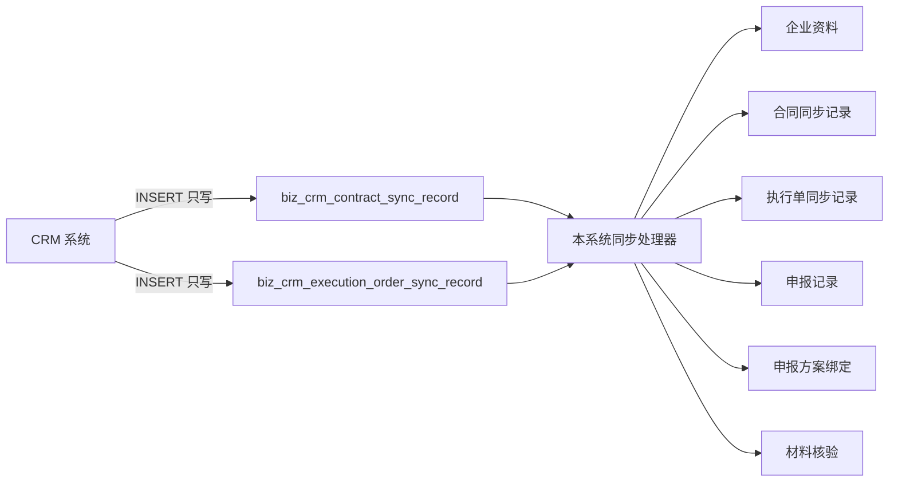

# CRM 直连数据库同步方案

## 背景

当前 CRM 接口对接不稳定，或者暂时无法建立稳定接口时，可以让 CRM 直接写入本系统的“同步入口表”，由本系统继续完成企业导入、合同关联、执行单处理、申报创建、方案绑定和材料核验。

这个方案的核心原则是：**CRM 只写入收件箱表，不直接写正式业务表**。

## 目标

1. 不依赖 CRM HTTP 接口，也能接收 CRM 的合同和执行单数据。
2. 保持本系统现有的 CRM 处理逻辑可复用。
3. 保证幂等、可重试、可追踪。
4. 保证 CRM 创建的“国家高新技术企业”申报能自动绑定已发布方案。

## 推荐架构



## 为什么不建议 CRM 直写正式业务表

正式业务表之间存在强关联：

- `biz_client_declaration`
- `biz_declaration_scheme`
- `biz_declaration_material_check`
- `biz_enterprise_*`

如果 CRM 直接写这些表，很容易造成：

- 有申报记录，但没有方案
- 有申报记录，但没有企业上下文
- 有申报记录，但没有材料检查结果
- 后台详情页无法展示完整链路

你前面遇到的“申报详情没有命中国家高新技术企业”，本质上就是这类问题。

## 数据落点

### 1. CRM 只写两张同步入口表

#### 合同表

表名：`biz_crm_contract_sync_record`

关键字段：

- `source_request_id`：CRM 侧唯一请求 ID，必须唯一
- `company_name`：客户公司名
- `contract_no`：合同号
- `customer_contract_no`：客户合同号
- `sequence_no`：序列号，可选
- `payload_json`：原始请求内容
- `process_status`：`received` / `processing` / `success` / `failed` / `skipped`
- `failure_reason`：失败原因
- `retry_count`：重试次数
- `last_processed_at`：最近处理时间

#### 执行单表

表名：`biz_crm_execution_order_sync_record`

关键字段：

- `source_request_id`：CRM 侧唯一请求 ID，必须唯一
- `order_no`：执行单号
- `company_name`：客户公司名
- `contract_no`：合同号
- `execution_order_name`：执行单名称
- `payload_json`：原始请求内容
- `process_status`：`received` / `processing` / `success` / `failed` / `skipped`
- `failure_reason`：失败原因
- `retry_count`：重试次数
- `last_processed_at`：最近处理时间

### 2. 本系统继续消费同步记录

处理器做的事：

1. 校验数据完整性。
2. 根据公司名/合同号/执行单号查重。
3. 导入或关联企业。
4. 创建合同、执行单、申报记录。
5. 自动匹配并绑定申报方案。
6. 写处理状态和失败原因。

## CRM 写入方式

### 建议权限

CRM 数据库账号建议只允许：

- `INSERT`
- 必要时 `SELECT`

不建议给：

- `UPDATE`
- `DELETE`
- 正式业务表写权限

### 推荐写入策略

CRM 每次新增业务事件时，只写同步入口表一条记录。

示意：

```sql
INSERT INTO biz_crm_execution_order_sync_record (
  source_request_id,
  order_no,
  company_name,
  contract_no,
  contract_review_status,
  execution_order_name,
  is_carried_forward,
  execution_department,
  account_manager_name,
  product_manager_name,
  payload_json,
  process_status,
  retry_count,
  last_processed_at,
  created_at,
  updated_at
) VALUES (
  'crm-exec-20260723-0001',
  'EXEC-001',
  '某某科技有限公司',
  'HT-2026-001',
  'approved',
  '2026年国家高新技术企业申报，15件知识产权',
  'no',
  '市场部',
  '张三',
  '李四',
  '{"sourceRequestId":"crm-exec-20260723-0001"}',
  'received',
  0,
  NULL,
  NOW(),
  NOW()
);
```

## 本系统处理流程

### 合同同步

1. 读取 `biz_crm_contract_sync_record` 中 `process_status='received'` 的记录。
2. 进入处理中状态 `processing`。
3. 解析 payload。
4. 导入企业或关联已有企业。
5. 更新处理结果为 `success` 或 `failed`。

### 执行单同步

1. 读取 `biz_crm_execution_order_sync_record` 中 `process_status='received'` 的记录。
2. 进入处理中状态 `processing`。
3. 解析执行单名称，识别项目代码。
4. 关联企业。
5. 为对应项目创建申报。
6. 自动绑定申报方案。
7. 写入 `declarationIdsJson` 和处理状态。

## 国家高新技术企业方案绑定规则

执行单同步创建申报时，应该自动匹配 `biz_declaration_scheme`：

1. `project_id` 必须等于国家高新技术企业项目 ID。
2. `status='published'`。
3. `region_id IS NULL` 时作为默认方案优先。
4. 如果未来扩展地区方案，再按更具体地区和有效期排序。
5. 写入申报记录时同时落库：
   - `scheme_id`
   - `scheme_version`
   - `snapshot_json.scheme`

这样后台申报详情才能命中：

- 已应用方案
- 准入规则
- 高企评分
- 流程节点

## 幂等规则

必须保证重复写入不会重复生成业务数据。

### 唯一键

- `source_request_id` 唯一

### 重复处理原则

1. 如果 `source_request_id` 已存在，直接返回已存在记录。
2. 如果记录已成功处理，重复写入不应重复创建企业或申报。
3. 处理失败后允许重试。

## 状态定义

### 同步记录状态

- `received`：已接收，未处理
- `processing`：处理中
- `success`：处理成功
- `failed`：处理失败
- `skipped`：已跳过，例如名称未识别到项目

### 处理失败示例

- company name 为空
- 合同号重复冲突
- 企业未找到
- 申报项目未识别
- 当前项目没有已发布方案

## 处理失败后的建议

1. 在后台同步记录页查看失败原因。
2. 修正 CRM 数据后重试。
3. 如是项目或方案问题，先补政策项目和申报方案，再重试。

## 同步方式建议

### 方案 A：CRM 直接 INSERT 中间表

适合：CRM 侧已有数据库写权限，且不方便对接 HTTP 接口。

优点：

- 实现简单
- CRM 改动少
- 本系统逻辑复用高

缺点：

- CRM 需要知道目标库连接信息
- 要做好权限隔离

### 方案 B：CRM 写它自己的库，再由本系统定时拉取

适合：CRM 不方便直连业务库，只能访问自己的库。

优点：

- 安全边界更清晰
- 业务库不暴露给 CRM

缺点：

- 多一层同步
- 需要游标和调度任务

### 推荐选择

如果 CRM 能稳定连到本系统数据库，优先选方案 A，但只允许写同步入口表。

## 数据库轮询配置

本系统启动后会自动轮询同步入口表，先处理合同，再处理执行单。CRM 只需插入状态为 `received` 的记录，不需要调用任何 HTTP 接口。

在 `backend/.env` 配置：

```dotenv
# 设为 0 时停止自动轮询，后台的手动重试不受影响
CRM_SYNC_POLL_ENABLED=1
# 每次扫描间隔，单位毫秒
CRM_SYNC_POLL_INTERVAL_MS=30000
# 每种记录类型每轮最多处理的数量
CRM_SYNC_BATCH_SIZE=20
# 首次处理失败后最多自动重试次数；达到上限后由后台人工处理
CRM_SYNC_MAX_RETRY=3
# processing 超过该时长会被视为超时并纳入自动重试，单位毫秒
CRM_SYNC_PROCESSING_TIMEOUT_MS=900000
```

轮询会消费以下记录：

- `received`：首次自动处理。
- `failed`：`retry_count` 未达到 `CRM_SYNC_MAX_RETRY` 时自动重试。
- 超时的 `processing`：按重试处理，避免进程中断造成记录永久卡住。

`success` 和 `skipped` 不会再次自动处理。达到自动重试上限的 `failed` 或超时 `processing` 记录保留给后台人工检查和重试。

## 实施步骤

### 第一阶段

1. 给 CRM 一个只写同步入口表的数据库账号。
2. 让 CRM 写入执行单和合同同步记录。
3. 复用现有 `CrmSyncService` 消费记录。

### 第二阶段

1. 为执行单同步补方案自动绑定。
2. 为历史 CRM 创建的申报补 `scheme_id` 和 `scheme_version`。

### 第三阶段

1. 后台同步记录页增加“立即处理/重试”按钮。
2. 增加同步统计。
3. 必要时增加定时巡检任务。

## 当前仓库里已具备的基础

- `biz_crm_contract_sync_record`
- `biz_crm_execution_order_sync_record`
- CRM 同步处理服务 `CrmSyncService`
- 国家高新技术企业项目和已发布方案
- 申报详情页已支持按 `scheme_id` 展示完整方案信息

## 结论

最稳妥的做法不是 CRM 直写正式业务表，而是 **CRM 直写同步入口表，本系统再消费处理**。

这样既能绕开 CRM 接口，又能保住申报、方案、材料核验、后台详情展示的一致性。
