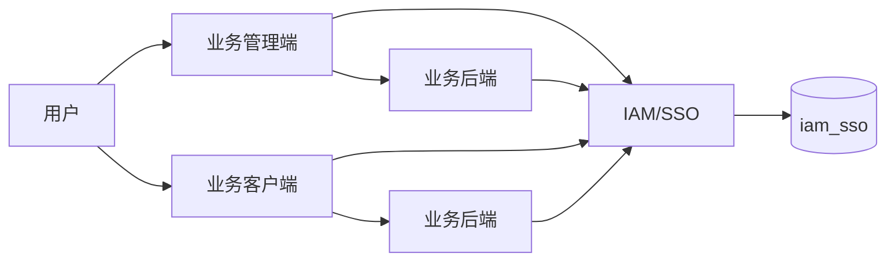

# 统一 IAM/SSO 设计方案

## 1. 目标与边界

IAM 是所有业务系统的统一身份和访问管理中心，负责：用户、应用、OAuth 客户端、角色、权限码、菜单、公司访问授权索引、负责人/成员身份、公司范围、平台内部部门、SSO 会话、令牌和审计。

业务系统继续负责自己的业务数据和业务规则，包括公司基本资料与公司详情。业务系统不得再独立维护用户、角色、权限、菜单和公司范围的第二份主数据。

新系统接入请按 [接入实施指南](./docs/IAM-接入实施指南.md) 执行，并使用 [接口参考](./docs/IAM-接口参考.md) 与 [上线验收清单](./docs/IAM-上线验收清单.md) 完成联调和上线。



## 2. 逻辑模型

| 范围 | 核心表 | 说明 |
| --- | --- | --- |
| 用户 | `iam_user`、`iam_user_source_identity` | IAM 用户及旧系统来源映射 |
| 应用 | `iam_app`、`iam_oauth_client`、`iam_user_app` | 应用登记、OAuth 客户端、用户应用访问权 |
| 授权 | `iam_role`、`iam_permission`、`iam_role_permission`、`iam_user_role`、`iam_menu` | 每个应用独立维护角色、权限码、菜单和分配关系 |
| 公司访问授权 | `iam_company`、`iam_company_member`、`iam_user_company_scope`、`iam_user_app_context` | 业务系统同步的轻量公司索引、负责人/成员身份、数据范围和应用级默认公司；不承载公司主数据或详情 |
| 平台组织 | `iam_platform_department`、`iam_user_platform_department` | 平台内部部门树、负责人、成员和主部门 |
| SSO | `iam_sso_session`、`iam_oauth_authorization_code`、`iam_refresh_token` | SSO 会话、授权码 PKCE、刷新令牌轮换 |
| 审计 | `iam_audit_event`、`iam_admin_session` | 登录、SSO、令牌、管理操作和管理员会话 |

关键约束：

- `app_code` 不可修改，避免 OAuth、角色、权限、菜单、公司范围关联失效。
- 角色、权限和菜单都必须带 `app_code`，禁止跨应用复用业务管理员角色。
- `iam_admin` 应用下的 `super_admin` 才能访问 `/iam/admin/*`。
- 公司在业务系统中的主键通过 `iam_company.source_company_id` 映射。
- `dataScope=all` 仅能展开 `iam_app.company_source_system` 对应的数据域。
- 平台部门为全局内部组织树，不绑定公司；服务端拒绝循环层级，用户可兼岗但只能有一个主部门。

## 3. Token 与 SSO

使用 OAuth 2.0 Authorization Code + PKCE，访问令牌为 RS256 JWT，公钥通过 `/.well-known/jwks.json` 发布。

JWT 主要声明：

```json
{
  "iss": "https://iam.example.com",
  "sub": "iam-user-id",
  "aud": "business_web_client_id",
  "app_code": "business_app_code",
  "preferred_username": "user_name",
  "name": "User Name",
  "roles": ["role_code"],
  "permissions": ["Resource:Action"],
  "home_path": "/dashboard/workspace",
  "exp": 0
}
```

公司范围不写入 JWT。业务后端需要通过 `GET /iam/me/apps/:appCode/companies` 获取公司上下文并短暂缓存；IAM 不可用时必须拒绝公司范围请求。

刷新令牌由 SPA SDK 保存到调用方提供的 `sessionStorage`，每次刷新都会轮换。统一注销会撤销 SSO 会话和刷新令牌。

## 4. 接口清单

| 接口组 | 用途 |
| --- | --- |
| `/oauth/session`、`/oauth/authorize`、`/oauth/token`、`/oauth/revoke`、`/oauth/logout` | SSO 登录、PKCE 授权码、令牌、撤销和注销 |
| `/.well-known/jwks.json`、`/.well-known/openid-configuration` | JWT 验签与协议发现 |
| `/iam/me` | 当前用户基础资料 |
| `/iam/me/apps/:appCode/permissions` | 当前应用权限码 |
| `/iam/me/apps/:appCode/menus` | 当前应用授权菜单 |
| `/iam/me/apps/:appCode/companies` | 当前应用可访问公司范围 |
| `/iam/me/apps/:appCode/companies/:companyId/default` | 持久化应用级默认公司 |
| `/iam/admin/apps`、`/users`、`/platform-departments` | IAM 管理端资源管理 |
| `/iam/admin/apps/:appCode/roles|permissions|menus|clients` | 应用授权资源管理 |
| `/iam/admin/audit/events` | 安全审计查询 |

## 5. 前端规范

业务 SPA 使用 `@kjqb/iam-spa-sdk`：

1. 未登录访问业务页面时跳转 IAM `/oauth/authorize`。
2. 回调页调用 `finishAuthorization` 校验 `state` 并兑换授权码。
3. 将 access token 写入现有访问令牌 store。
4. 从 JWT 读取权限码，从 IAM 获取菜单和公司上下文。
5. 单次 `401` 使用 SDK 刷新令牌后重试；刷新失败则回到 IAM 登录。
6. 注销时调用 IAM 统一注销，并清理本地 store。

回调 URL 必须逐字符匹配 OAuth Client 的白名单。浏览器访问主机也必须与回调 URL 主机一致，例如 `localhost` 与 `127.0.0.1` 的 session storage 不共享，不能混用。

## 6. 后端 Guard 规范

业务后端使用 `@kjqb/iam-node-sdk` 或当前 `IamJwtVerifierService`：

1. 验证 JWT 的 `iss`、`aud`、`app_code`、签名、过期时间。
2. 将 `permissions` 放入当前请求用户上下文。
3. 使用 `PermissionGuard` 检查接口权限码。
4. 使用 `PortalGuard` 限制 admin/client 门户。
5. 对公司拥有的数据，先从 IAM 读取公司范围，再判断资源公司 ID 是否在授权集合中。
6. `dataScope=all` 仅在应用的数据源域内有效。
7. IAM 公司上下文不可用时，禁止继续访问公司数据。

## 7. 当前系统迁移

| 系统 | 应用编码 | OAuth Client | 门户 | 默认首页 |
| --- | --- | --- | --- | --- |
| IAM 管理端 | `iam_admin` | IAM 管理端本地会话 | `admin` | `/iam/overview` |
| 科创企服管理端 | `kjqb_admin` | `kjqb_admin_web` | `admin` | `/dashboard` |
| 科创企服客户端 | `kjqb_client` | `kjqb_client_web` | `client` | `/dashboard/workspace` |

迁移顺序：

1. 在独立 `iam_sso` 数据库执行 IAM 迁移。
2. 预览并执行旧系统数据导入，保留 `source_user_id` 与 `source_company_id` 映射。
3. 创建 IAM 管理员，并关闭生产环境 bootstrap 登录。
4. 在 IAM 管理端核对应用、回调地址、角色、权限、菜单、公司负责人和公司范围。
5. 先将业务前端切换到 `VITE_AUTH_MODE=iam`。
6. 验证 SSO、回调、菜单和公司上下文后，再将业务后端切换到 `IAM_AUTH_MODE=jwt`。
7. 逐系统完成验收后，下线业务系统中的本地用户、角色、权限、菜单、公司范围管理入口。

## 8. 多系统接入模板

每一个新系统必须独立登记：

```text
系统名称：
应用编码：
前端地址：
后端地址：
OAuth Client ID：
回调地址：
登出回调地址：
门户：admin / client
公司数据源：
是否需要公司范围：
初始角色：
初始权限码：
初始菜单：
IAM 负责人：
业务迁移负责人：
回滚负责人：
```

## 9. 验收与运行

- IAM 管理端：`http://127.0.0.1:6101/`
- IAM 后端健康检查：`http://127.0.0.1:3101/health`
- 业务后端：`http://127.0.0.1:3000/health`
- 本地 JWT 跨服务验收：在 `backend` 执行 `npm run verify:iam-client-e2e`

生产部署和密钥轮换见 `iam/deploy/DEPLOYMENT.md`，新系统接入步骤见 `iam/INTEGRATION-KIT.md`。

现有管理端和客户端的 IAM 环境变量模板见：

- `iam/templates/kjqb-admin.iam.env.example`
- `iam/templates/kjqb-client.iam.env.example`
