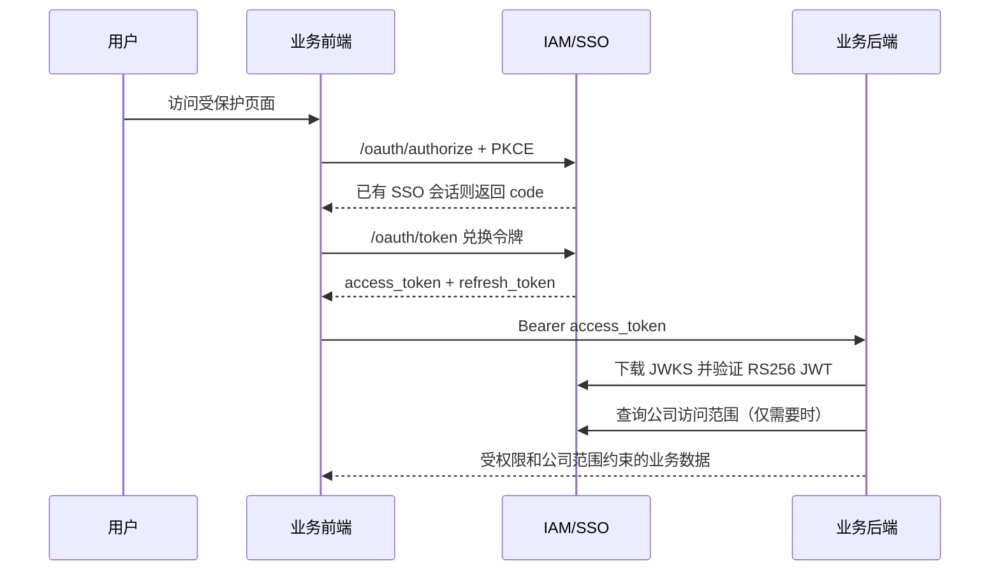

# IAM/SSO 接入实施指南

本文面向要接入 IAM 的新业务系统。目标是让多个系统共用一套登录、用户、应用授权、角色权限、菜单和公司访问范围，同时保留各业务系统自己的业务数据与业务规则。

配套文档：

- [接口参考](./IAM-接口参考.md)
- [上线与验收清单](./IAM-上线验收清单.md)
- [总体设计](../IAM-SOLUTION.md)

## 1. 接入边界

| IAM 负责 | 业务系统负责 |
| --- | --- |
| 用户、登录、SSO 会话、OAuth Client、令牌、应用访问权 | 业务数据、业务规则、业务审批与业务操作日志 |
| 应用内角色、权限码、菜单和用户角色分配 | 调用 IAM 权限码保护本系统 API |
| 公司访问授权、负责人/成员身份、默认公司 | 公司基本资料、公司详情及公司业务数据 |
| 平台内部组织与员工部门归属 | 不建立公司部门模型，也不把平台部门作为公司数据范围 |

`iam_company` 是由业务系统导入或同步的轻量公司索引，只用于授权关联。业务系统仍是公司资料的唯一主数据来源。

## 2. 总体流程



同一浏览器访问第二个业务系统时，IAM 的 `iam_sso_session` Cookie 仍有效，第二个系统会直接拿到授权码，不应再次要求输入账号密码。

## 3. 系统接入步骤

### 3.1 填写接入登记单

每个新系统必须先确定以下信息，之后由 IAM 管理员在管理端登记：

```text
系统名称：
应用编码 appCode：
前端地址：
后端地址：
门户：admin / client
OAuth Client ID：
授权回调地址 redirectUri：
登出后回调地址：
默认首页：
是否有公司归属数据：是 / 否
公司数据源 sourceSystem：
初始角色：
初始权限码：
初始菜单：
业务系统负责人：
IAM 管理员：
计划上线时间：
```

规则：

1. `appCode` 使用小写字母、数字和下划线，例如 `project_center`，创建后不修改。
2. 每个浏览器前端创建一个 `public` OAuth Client；服务端渲染或机密后端按需创建 `confidential` Client。
3. `redirectUri` 必须逐字符匹配，包括协议、域名、端口、路径。`localhost` 和 `127.0.0.1` 不可混用。
4. 有公司归属数据的系统必须配置 `companySourceSystem`，它决定 `dataScope=all` 的边界。

### 3.2 在 IAM 管理端完成配置

依次执行：

1. 在“应用列表”创建应用，填写 `appCode`、名称、门户、默认首页和公司数据源。
2. 在应用的 SSO Client 配置中创建 OAuth Client，登记回调地址、登出地址和令牌有效期。
3. 创建权限码，例如 `Project:Read`、`Project:Create`、`Project:Approve`。
4. 创建角色并绑定权限码。
5. 创建该应用自己的菜单树，菜单的 `authCode` 与权限码对应。
6. 给用户授予应用访问权，再给用户分配该应用角色。
7. 若系统使用公司数据，在“公司访问授权”中给用户设置负责人、成员或项目老师身份、数据范围和默认公司。

不要给业务用户分配 `iam_admin/super_admin`。该角色只允许访问 IAM 管理接口。

### 3.3 前端接入 OAuth + PKCE

推荐直接使用 `@kjqb/iam-spa-sdk`：

```json
{
  "dependencies": {
    "@kjqb/iam-spa-sdk": "file:../new_kjqb/iam/packages/iam-spa-sdk"
  }
}
```

环境变量：

```env
VITE_AUTH_MODE=iam
VITE_IAM_ISSUER=https://iam.example.com
VITE_IAM_CLIENT_ID=project_center_web
VITE_IAM_REDIRECT_URI=https://project.example.com/auth/callback
VITE_APP_CODE=project_center
```

在应用启动时创建单例：

```ts
import { IamSpaClient } from '@kjqb/iam-spa-sdk';

export const iamClient = new IamSpaClient({
  clientId: import.meta.env.VITE_IAM_CLIENT_ID,
  issuer: import.meta.env.VITE_IAM_ISSUER,
  redirectUri: import.meta.env.VITE_IAM_REDIRECT_URI,
  storage: sessionStorage,
});
```

未登录时跳转：

```ts
export async function startIamLogin(returnPath: string) {
  window.location.assign(await iamClient.createAuthorizationUrl(returnPath));
}
```

回调页只做授权码交换和页面跳转：

```ts
export async function handleIamCallback(currentUrl: string) {
  const { accessToken, claims, redirect } = await iamClient.finishAuthorization(currentUrl);
  accessStore.setAccessToken(accessToken);
  accessStore.setAccessCodes(claims.permissions ?? []);
  await router.replace(redirect || claims.home_path || '/');
}
```

前端运行规则：

1. `access_token` 只放内存或项目现有 access store；SDK 把轮换型 `refresh_token` 放在调用方传入的 `sessionStorage`。
2. 请求业务 API 时添加 `Authorization: Bearer <access_token>`。
3. 收到一次 `401` 时调用 `iamClient.refresh()`，替换 access token 后只重试一次；再次失败立即清理本地状态并转去 IAM 登录。
4. 菜单从 `GET /iam/me/apps/:appCode/menus` 获取，前端不得把 IAM 菜单与其他应用菜单混用。
5. 用户登出时调用 `iamClient.logout()`，然后清空业务前端的 token、菜单、用户与公司上下文。

### 3.4 后端验证 JWT 与权限

Node/NestJS 推荐使用 `@kjqb/iam-node-sdk`：

```json
{
  "dependencies": {
    "@kjqb/iam-node-sdk": "file:../new_kjqb/iam/packages/iam-node-sdk"
  }
}
```

后端环境变量：

```env
IAM_AUTH_MODE=jwt
IAM_ISSUER=https://iam.example.com
IAM_JWKS_URL=https://iam.example.com/.well-known/jwks.json
IAM_CONTEXT_URL=https://iam.example.com
IAM_APP_CODE=project_center
IAM_CLIENT_ID=project_center_web
IAM_PORTAL=admin
IAM_COMPANY_SOURCE_SYSTEM=project_center_db
IAM_CONTEXT_TIMEOUT_MS=5000
IAM_COMPANY_SCOPE_CACHE_TTL_MS=30000
```

在进程启动时创建一个验证器并复用：

```ts
import { IamCompanyContextClient, IamJwtVerifier } from '@kjqb/iam-node-sdk';

export const verifier = new IamJwtVerifier({
  appCode: process.env.IAM_APP_CODE!,
  audience: process.env.IAM_CLIENT_ID!,
  issuer: process.env.IAM_ISSUER!,
  jwksUrl: process.env.IAM_JWKS_URL!,
});

export const companyContext = new IamCompanyContextClient({
  appCode: process.env.IAM_APP_CODE!,
  baseUrl: process.env.IAM_CONTEXT_URL ?? process.env.IAM_ISSUER!,
});
```

Guard 中必须检查：签名算法为 RS256、JWKS `kid`、`iss`、`aud`、`app_code`、过期时间与 `nbf`。不得只解码 JWT 而不验签。

```ts
const accessToken = request.headers.authorization?.replace(/^Bearer\s+/i, '');
const user = await verifier.verify(accessToken ?? '');
if (!user.permissions.includes('Project:Read')) {
  throw new ForbiddenException();
}
request.user = user;
```

### 3.5 公司范围接入

仅当业务记录属于公司时使用公司范围。每次需要公司判定的请求，后端获取 IAM 范围并短暂缓存：

```ts
const scopes = await companyContext.listCompanies(accessToken);
const allScope = scopes.some((scope) => scope.dataScope === 'all');
const companyIds = new Set(scopes.map((scope) => scope.sourceCompanyId).filter(Boolean));

if (!allScope && !companyIds.has(String(resource.companyId))) {
  throw new ForbiddenException('无权访问该公司数据');
}
```

约束：

- `sourceCompanyId` 必须与本业务库公司主键保持稳定映射。
- `dataScope=assigned` 只能访问已授权公司的数据。
- `dataScope=all` 只能访问应用 `companySourceSystem` 对应数据域内的全部公司。
- IAM 公司范围接口超时、失败或响应无效时必须拒绝公司数据请求，不能放行。
- 平台组织与公司范围无关，业务后端不要调用部门接口作为公司过滤条件。

### 3.6 公司索引同步

公司新增、名称变更、停用时，由业务系统的导入任务或同步任务调用 IAM 管理接口更新轻量索引。同步字段至少为：

```json
{
  "companyName": "示例科技有限公司",
  "sourceCompanyId": "10001",
  "sourceSystem": "project_center_db",
  "status": 1
}
```

IAM 管理前端不编辑公司资料。`POST/PUT /iam/admin/companies` 仅用于受控同步任务、初始化和测试，调用方必须是 IAM 管理员服务身份。

## 4. 菜单、权限与角色规范

建议权限码格式为 `资源:动作`，使用 PascalCase，例如：

```text
Project:Read
Project:Create
Project:Update
Project:Approve
Project:Export
```

菜单仅定义导航与前端路由，后端 API 仍必须使用权限 Guard。一个推荐关系是：

```text
角色 -> 权限码 -> 菜单 authCode -> 前端路由
```

示例菜单：

```json
{
  "menuName": "项目管理",
  "menuType": "menu",
  "path": "/projects",
  "component": "projects/index",
  "authCode": "Project:Read",
  "sortOrder": 10,
  "status": 1
}
```

## 5. 用户迁移与切换顺序

1. 先导入或同步用户，保留原系统用户 ID 到 `source_user_id` 的映射。
2. 导入公司轻量索引，保留业务公司主键到 `source_company_id` 的映射。
3. 配置应用、Client、角色、权限码和菜单。
4. 分配用户应用访问权、角色和公司范围。
5. 前端先灰度启用 `VITE_AUTH_MODE=iam`，验证登录与回调。
6. 后端再灰度启用 `IAM_AUTH_MODE=jwt`，验证 JWT 与公司过滤。
7. 验收通过后，移除业务系统本地用户、角色、权限、菜单和公司范围的管理入口；保留公司资料管理入口。

## 6. 本地调试

| 服务 | 地址 |
| --- | --- |
| IAM 管理前端 | `http://127.0.0.1:6101` |
| IAM 后端 | `http://127.0.0.1:3101` |
| IAM 健康检查 | `http://127.0.0.1:3101/health` |
| OIDC 发现 | `http://127.0.0.1:3101/.well-known/openid-configuration` |
| JWKS | `http://127.0.0.1:3101/.well-known/jwks.json` |

当前系统可运行跨服务验证：

```powershell
Set-Location backend
npm run verify:iam-client-e2e
```

该验证会启动隔离业务后端，创建临时 IAM 用户，校验 SSO、JWT、菜单、公司范围、刷新和登出后自动清理数据。
